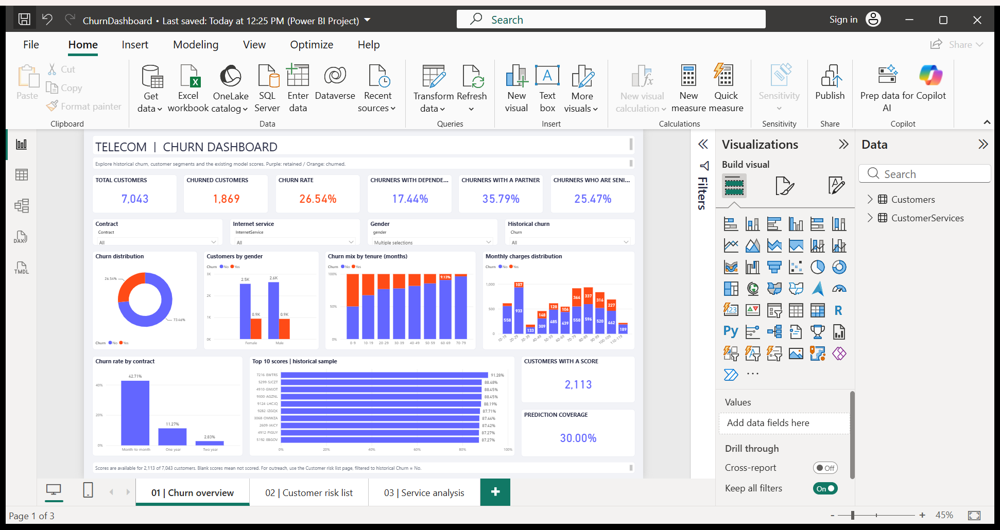
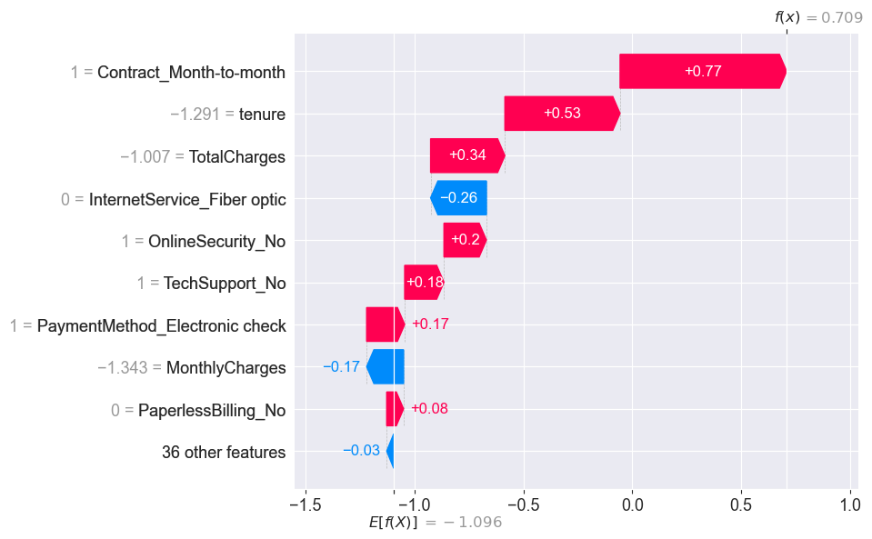

# Telecom Customer Churn Analysis and Prediction

A customer churn analytics project combining **Python machine learning** with an interactive **Power BI dashboard**. Explore historical churn patterns, compare customer segments, and review customers ranked by their saved model scores.

[Open the Power BI project](PowerBI/ChurnDashboard.pbip) | [Dashboard guide](PowerBI/START_HERE.md) | [Analysis notebook](churn.ipynb)



## Project at a glance

| Item | Value |
|---|---:|
| Customers in the source dataset | 7,043 |
| Customers labeled as churned | 1,869 |
| Historical churn rate | 26.54% |
| Customers with saved prediction scores | 2,113 |
| Prediction coverage | 30.00% |
| Power BI report pages | 3 |
| Semantic model tables / relationships / measures | 3 / 2 / 19 |

The data is a historical snapshot. Prediction scores are available for a subset of customers; the other **4,930 customers remain unscored**, with blank probabilities.

## Business questions

- How does churn vary by tenure, contract, internet service, and payment method?
- Which customer segments have the highest historical churn rates?
- Which scored customers should be reviewed first for possible retention outreach?
- Which features influence the model's predictions?

## Power BI dashboard

### 1. Churn overview

The overview combines customer counts, churn rate, demographic KPIs, and prediction coverage with interactive filters for contract, internet service, gender, and historical churn.

Charts show churn distribution, customer counts by gender, churn proportions by tenure, monthly charge distributions, churn rate by contract, and the ten highest scores in the selected historical sample.

The dependents, partner, and senior citizen cards show **shares among churned customers**: 17.44%, 35.79%, and 25.47%, respectively. These differ from the churn rate within each demographic group.

### 2. Customer risk list

A customer-level worklist with churn probabilities, risk bands, contract and service details, tenure, and monthly charges. Filters let you explore customer IDs and segments, while a top-ten chart highlights the highest scores in the current selection.

The page defaults to customers with a saved score and a historical `Churn = No` label: **1,539 customers**, including **26** in the high-risk band before additional filtering.

| Risk band | Saved churn probability |
|---|---|
| High | 70% or greater |
| Medium | 40% to less than 70% |
| Low | Less than 40% |
| Not scored | No saved prediction |

These bands are configurable reporting rules. They have not been optimized against retention costs or validated as intervention thresholds. The historical churn label also does not establish a customer's current status.

### 3. Service analysis

Compare churn rates and customer counts across service categories, with additional charts for payment method and internet service. The service selector defaults to **Streaming movies** and supports 12 service or account attributes.

The service selector controls the two service-category charts. Contract and internet-service filters apply across the page. Select one service at a time for a straightforward category comparison.

## Open the dashboard

The report, queries, relationships, and measures are already included. Python is not required to open or refresh the dashboard.

1. Open [PowerBI/ChurnDashboard.pbip](PowerBI/ChurnDashboard.pbip) in Power BI Desktop. Keep its sibling `ChurnDashboard.Report` and `ChurnDashboard.SemanticModel` folders together.
2. Check the source location under **Transform data > Edit parameters**. Set `DataFolder` to the folder containing `Telco-Customer-Churn.csv` and `results.csv`, with a trailing slash. The saved path is:

   ```text
   D:/Projects/Churn-Analysis-and-Prediction-main/Data/
   ```

3. Apply any parameter change, then select **Home > Refresh**.
4. With overview filters cleared, confirm **7,043 customers**, **1,869 churners**, and **26.54% churn**.
5. Explore the three page tabs. To create a single-file report, use **File > Save as > Browse this device** and choose **Power BI Desktop file (*.pbix)**.

The repository delivers an editable **PBIP project**; a standalone PBIX copy is not included. See the [dashboard guide](PowerBI/START_HERE.md) for project-format settings, source-path troubleshooting, and export instructions.

Refreshing rereads the CSV files. It does not retrain a model or generate new prediction scores.

## Data and semantic model

[Data/Telco-Customer-Churn.csv](Data/Telco-Customer-Churn.csv) contains 7,043 rows and 21 columns: a customer identifier, 19 potential input features, and the binary `Churn` target. Features cover demographics, account tenure, contracts, subscribed services, payment methods, and charges.

[Data/results.csv](Data/results.csv) contains 2,113 customer IDs, processed model inputs, and a `ChurnProb` score. The dashboard imports the IDs and scores and joins them to the original customer records, preserving raw tenure and charge values for reporting.

| Power BI table | Contents | Rows |
|---|---|---:|
| `Customers` | Original customer records, joined scores, risk bands, and reporting categories | 7,043 |
| `Predictions` | Customer IDs and saved churn probabilities; hidden in report view | 2,113 |
| `CustomerServices` | Twelve service/account attributes unpivoted by customer | 84,516 |

`Customers[customerID]` filters both other tables through one-to-many, single-direction relationships. Service measures count distinct customer IDs to avoid counting each customer's multiple service rows as separate customers.

Power Query converts numeric fields, replaces 11 blank `TotalCharges` values with zero, preserves missing prediction scores as null, and creates ten-unit tenure and monthly-charge bands.

Dataset attribution: **Telco Customer Churn**, distributed through the [Kaggle dataset listing](https://www.kaggle.com/datasets/blastchar/telco-customer-churn).

## Python analysis and modeling

The [notebook](churn.ipynb) contains the exploratory analysis, preprocessing, classifier comparisons, tuning, interpretation, and prediction export workflow.

1. Explore class balance and churn patterns across customer attributes.
2. Remove customer IDs from model inputs, encode categorical features, and standardize numerical features.
3. Benchmark classifiers with LazyPredict and compare individual models.
4. Tune SVC, RidgeClassifierCV, Logistic Regression, AdaBoost, and XGBoost using cross-validation.
5. Interpret XGBoost with split-based feature importance, permutation importance, LIME, and SHAP.
6. Evaluate the selected model and produce customer-level churn scores.

The notebook contains **two separate XGBoost workflows**:

| Workflow | Saved artifact | Configuration | Processed features |
|---|---|---|---:|
| Main evaluation | `best_model.sav` | Depth 3, learning rate 0.01, 500 estimators | 45 |
| Customer score export | `churn_list.sav` | Depth 4, learning rate 0.01, 500 estimators | 44 |

Both `.sav` files contain trained model objects. Despite its name, `churn_list.sav` is a model, not a serialized customer list. The exported scores come from the second workflow, which excludes `SeniorCitizen`.

### Recorded model results

These values come from the notebook's saved outputs; they are not a new training run.

| Metric | Main model: test set | Score-export model: validation set |
|---|---:|---:|
| Evaluated customers | 1,057 | 2,113 |
| Accuracy | 81.93% | 80.41% |
| Churn-class precision | Approximately 70% | 67.94% |
| Churn-class recall | Approximately 57% | 52.79% |
| Churn-class F1 | Approximately 63% | 59.41% |

The main model's precision, recall, and F1 are rounded as displayed in its saved classification report. Its test metrics should not be attributed to the separate score-export model.

The analysis highlights associations involving shorter tenure, month-to-month contracts, charges, and internet service. Feature importance and individual explanations describe predictive relationships; they do not establish causes of churn.



## Explore the notebook

Start Jupyter from the repository root so its relative `Data/` paths resolve:

```bash
jupyter notebook churn.ipynb
```

The notebook imports pandas, NumPy, scikit-learn, XGBoost, LightGBM, LazyPredict, SHAP, LIME, Matplotlib, Seaborn, Plotly, and joblib. Its recorded kernel used Python 3.8.13; the repository does not include a pinned dependency environment.

The saved analysis can be reviewed directly. A clean rerun needs maintenance: some library calls use older APIs, `joblib` must be imported before loading a saved model, and model/CSV export statements are commented out. Reviewing the supplied dashboard does not require rerunning these cells.

## Repository layout

```text
.
|-- Data/
|   |-- Telco-Customer-Churn.csv        # Source customer records
|   |-- results.csv                    # Existing customer prediction scores
|-- PowerBI/
|   |-- ChurnDashboard.pbip            # Open this in Power BI Desktop
|   |-- ChurnDashboard.Report/         # Report pages, visuals, and theme
|   |-- ChurnDashboard.SemanticModel/  # Tables, relationships, and measures
|   |-- PowerQuery/                    # Reusable Power Query definitions
|   |-- Measures.dax                   # DAX measure reference
|   |-- Customers_PowerBI.csv          # Clean, merged fallback snapshot
|   |-- TelecomChurn.theme.json        # Dashboard color theme
|   |-- desktop-preview.png            # Dashboard screenshot
|   |-- START_HERE.md                  # Detailed dashboard instructions
|   |-- build_dashboard.py             # Project-generation script
|   |-- validate_dashboard.py          # Schema and field-reference checks
|   |-- desktop_automation.ps1          # Report-specific Desktop helper
|   |-- schemas/                       # Cached Microsoft schemas
|   |-- data_validation.json           # Data checks and baseline totals
|   |-- report_validation.json         # Generated report validation results
|   `-- desktop_validation.json        # Recorded Desktop verification
|-- screenshots/                       # Analysis and model-explanation charts
|-- churn.ipynb                        # Analysis and modeling notebook
|-- best_model.sav                     # Main evaluation model
|-- churn_list.sav                     # Separate customer-scoring model
`-- README.md
```

## Validation and development notes

The project was opened, refreshed, and saved in **Power BI Desktop 2.157.1354.0**. All three pages were checked, including the service selector and baseline customer totals. The generated report passed 54 JSON-schema checks before Desktop upgraded the report format on save.

The validation records are available in [data_validation.json](PowerBI/data_validation.json), [report_validation.json](PowerBI/report_validation.json), and [desktop_validation.json](PowerBI/desktop_validation.json).

`build_dashboard.py` regenerates the project definitions and fallback CSV. Running it after editing the report in Desktop can overwrite those edits. `validate_dashboard.py` requires `jsonschema` and fetches Microsoft schemas when they are not cached locally.

## Limitations and next steps

- **Model packaging:** preprocessing objects are not saved with the estimators. Package preprocessing and the model together before scoring new customers reliably.
- **Evaluation:** the score-export workflow fits preprocessing before its split, and the main tuning workflow preprocesses before cross-validation. Move preprocessing inside each training fold to avoid leakage.
- **ROC-AUC:** the shared evaluation helper uses binary predictions. Use probabilities or decision scores consistently; the later test ROC plot already uses probabilities.
- **Explainability:** the SHAP summary call pairs test explanations with validation features and needs correction before a clean rerun.
- **Reproducibility:** pin dependencies, update older APIs, and enable exports explicitly when producing new artifacts.
- **Operational use:** validate scores on fresh data, assess probability calibration, choose cost-aware thresholds, and measure retention outcomes before using the worklist for live campaigns.

## Technology stack

**Analysis:** Python, pandas, NumPy, Jupyter  
**Modeling:** scikit-learn, XGBoost, LightGBM, LazyPredict, joblib  
**Interpretation:** SHAP, LIME, permutation importance  
**Visualization:** Power BI Desktop, Power Query, DAX, Matplotlib, Seaborn, Plotly
